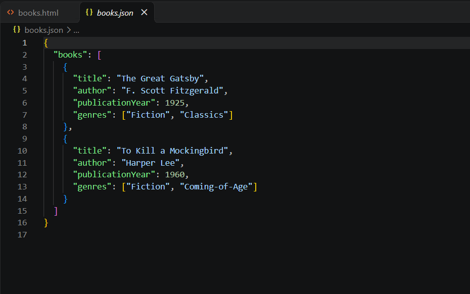
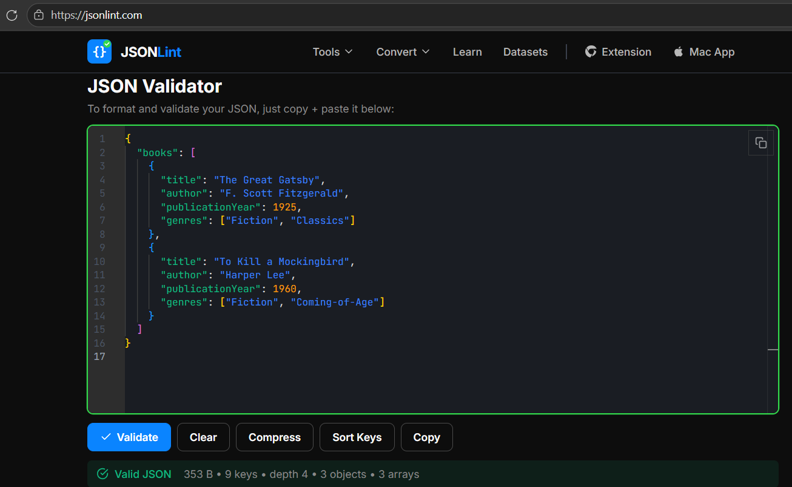
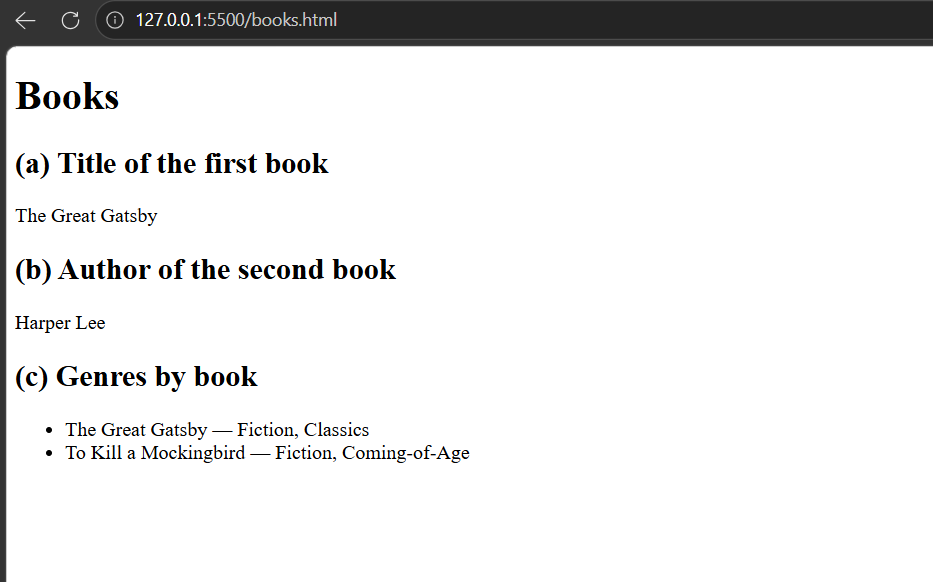
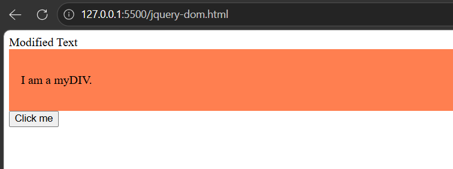
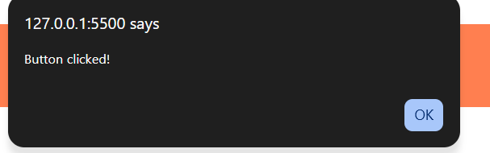

# BIC21203 Web Development - Lab 4b: Client-Side Scripting (JSON and jQuery)

**Name:** Lim Zheng Yu
**Matric No.:** AI240112
**Session:** 2026/2027

## Overview
This repository contains three exercises on creating a JSON dataset, fetching
and displaying it with native JavaScript, and comparing native DOM operations
with jQuery.

## Project structure
- `books.json` - JSON dataset of two books
- `books.html` - Fetches and displays the JSON data
- `jquery-dom.html` - jQuery DOM and event examples
- `screenshots/` - Output screenshots

## Setup instructions
1. Download or clone this repository.
2. Open the folder in VS Code and install the **Live Server** extension.
3. Right-click `books.html` and choose **Open with Live Server**
   (do not open it with file://, because fetch() will not work).
4. `jquery-dom.html` can also be opened with Live Server. An internet
   connection is needed because jQuery 4.0.0 loads from the official CDN.

## Question 1 - Create and Structure JSON Data
**Explanation:** `books.json` has a top-level "books" array with two book
objects. Each has title and author (strings), publicationYear (number) and
genres (array of strings). It uses double-quoted property names and no
trailing commas.

## Question 2 - Retrieve and Display JSON Data
**Explanation:** `books.html` uses the native `fetch()` API with async/await to
read `books.json`. It displays the first book's title, the second book's author
and the genres of both books grouped by title. Text is inserted with
`textContent` and `createElement()`, and a try/catch block shows a friendly
error message if loading fails. The page was run through a local server
(Live Server).

## Question 3 - Compare Native JavaScript and jQuery
**Explanation:** `jquery-dom.html` loads jQuery 4.0.0 (full build) from the
official CDN and uses `.text()` to change the text of #myElement, `.addClass()`
to add the myStyle class to #myDIV, and `.on("click", ...)` to show an alert
when the button is clicked.

**Advantage of native JavaScript:** It needs no extra library, so pages load
faster and have fewer dependencies.

**Why jQuery may still be used:** Existing or legacy projects may already depend
on jQuery and its plugins, and rewriting them would be costly.
